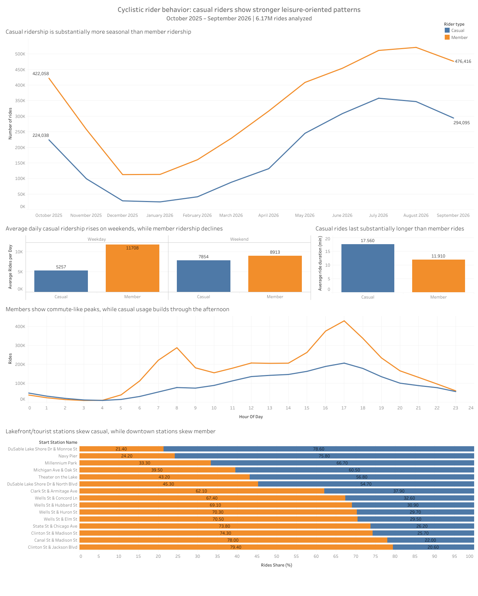

# Cyclistic Bike-Share Analysis

**Google Data Analytics Professional Certificate Capstone**

SQL- and Tableau-based analysis of approximately **6.17 million bike-share rides**, comparing casual riders and annual members to identify behavioral differences and inform membership-conversion strategies.

## Business problem

Cyclistic is a fictional bike-share company used in the Google Data Analytics capstone case study. The business goal is to increase the number of annual members.

The analytical question is:

> **How do annual members and casual riders use Cyclistic bikes differently?**

The purpose of the analysis is to identify evidence-based usage patterns that could help guide marketing strategies aimed at converting casual riders into annual members.

## Data

The project uses **12 monthly Divvy historical trip-data files**, covering **October 2025 through September 2026**.

- Raw source: https://divvy-tripdata.s3.amazonaws.com/index.html
- Combined raw dataset: **6,171,785 rows**
- Final processed dataset: **6,171,750 unique rides**

The raw CSV files are not included in this repository because they are large and publicly available from the original source. Download and local setup instructions are documented in [data/README.md](data/README.md).

## Tools

- **MySQL Community Server / SQL** — ingestion, validation, cleaning, transformation, and analysis
- **MySQL Workbench** — database interaction and query development
- **Tableau Public** — dashboard and data visualization
- **Git / GitHub** — version control and portfolio publication

## Workflow

The project follows the Google Data Analytics process:

**Ask → Prepare → Process → Analyze → Share → Act**

### Ask

Defined the business task: compare annual-member and casual-rider behavior and identify patterns that could inform conversion marketing.

### Prepare

Reviewed the 12 monthly source files, their common schema, data credibility, missing values, and limitations.

### Process

The SQL workflow:

- combines the 12 monthly datasets into a raw staging table;
- preserves the raw data unchanged;
- validates categorical fields and missing values;
- identifies **35 duplicated ride IDs** appearing across the April–May 2026 file boundary;
- retains one record per unique ride in the processed dataset;
- flags **29 non-positive ride durations** associated with the daylight-saving-time rollback;
- flags **5,324 rides longer than 24 hours** and excludes them from primary duration statistics;
- creates analytical variables including ride date, month, day of week, hour of day, weekend indicator, ride duration, and duration-quality flags.

The full reproducible SQL workflow is available in [sql/](sql/).

### Analyze

Annual members accounted for about **64.5%** of rides and casual riders about **35.5%**. The strongest result, however, was the consistency of several independent behavioral differences.

## Key findings

1. **Casual riding is substantially more seasonal.**  
   Both rider groups use the system more in warmer months, but casual ridership falls much more sharply during winter and rises much more strongly during spring and summer.

2. **Casual usage increases on weekends, while member usage declines.**  
   Casual riders averaged about **5,257 rides per weekday** and **7,854 per weekend day** — roughly a **49% increase**. Members averaged about **11,708 rides per weekday** and **8,913 per weekend day** — roughly a **24% decrease**.

3. **Casual rides are longer.**  
   Valid casual rides averaged about **17.6 minutes**, compared with **11.9 minutes** for members.

4. **Members show commute-like time-of-day peaks.**  
   Member usage has pronounced morning and late-afternoon peaks, while casual usage builds more gradually through the day and is concentrated more strongly in the afternoon.

5. **Station geography differs strongly between rider groups.**  
   Lakefront and visitor-oriented stations skew casual, while several downtown stations skew member. For example, about **75.8% of rides starting at Navy Pier** and **78.6% at DuSable Lake Shore Dr & Monroe St** were casual.

Taken together, these patterns are **consistent with** more leisure- or discretionary-oriented use among casual riders and more routine transportation among members. Because trip purpose is not explicitly recorded, this interpretation should not be treated as direct evidence of commuting or leisure.

## Dashboard

The Tableau dashboard summarizes the five main analytical views:

- monthly seasonality;
- weekday versus weekend usage;
- average ride duration;
- rides by hour of day;
- rider mix at high-traffic stations.

A static version is shown at the top of this README and stored in [images/cyclistic_dashboard.png](images/cyclistic_dashboard.png).

The aggregated CSV files used to build the dashboard are available in [output/](output/).

Presentation notes for the dashboard are available in [docs/presentation_notes.md](docs/presentation_notes.md).

## Recommendations

### 1. Target high-opportunity periods

Concentrate casual-to-member marketing during **spring and summer** and around **weekend usage**, when casual ridership is highest. Membership messaging could emphasize the value of an annual plan for customers who use the service repeatedly during these periods.

### 2. Target casual-heavy locations

Focus membership messaging at stations with a high share of casual rides, particularly lakefront and visitor-oriented locations such as **Navy Pier, Millennium Park, and DuSable Lake Shore Drive stations**. Possible approaches include location-specific in-app messages, station signage, or targeted promotions.

### 3. Experiment and measure conversion

Use controlled experiments such as **A/B tests** to evaluate different membership offers and messages. The current analysis identifies promising times, locations, and behavioral segments, but customer-level and campaign data would be needed to determine which interventions actually increase annual-membership conversion.

## Limitations and next steps

This dataset describes **rides rather than individual customers**. It does not contain a persistent rider identifier, demographics, or explicit trip-purpose information, so it cannot determine how frequently an individual casual customer rides or prove why a trip was made.

Additional privacy-compliant data could strengthen future analysis:

- an anonymized persistent customer identifier and membership history;
- trip-purpose or survey data;
- age group and gender for demographic segmentation;
- pricing and pass type;
- campaign exposure and conversion outcomes.

Station names and IDs are also missing for a substantial subset of rides, especially electric-bike trips. Therefore, station-based conclusions apply only to rides with available station information.

## Repository structure

~~~text
cyclistic-bike-share-analysis/
├── README.md
├── data/
│   └── README.md
├── docs/
│   └── presentation_notes.md
├── images/
│   └── cyclistic_dashboard.png
├── output/
│   ├── 01_monthly_rides.csv
│   ├── 02_weekday_weekend_rides.csv
│   ├── 03_hourly_rides.csv
│   ├── 04_average_duration.csv
│   └── 05_station_usage.csv
└── sql/
    ├── 01_create_database_and_tables.sql
    ├── 02_import_data.sql
    ├── 03_data_quality_checks.sql
    ├── 04_create_processed_table.sql
    └── 05_analysis.sql
~~~

## Reproducing the analysis

1. Clone this repository.
2. Download the monthly Divvy trip-data archives for **October 2025 through September 2026** from the [Divvy data archive](https://divvy-tripdata.s3.amazonaws.com/index.html).
3. Extract the CSV files into a local **data/raw/** directory as described in [data/README.md](data/README.md).
4. In MySQL, ensure **local_infile** is enabled and update the local file paths in [sql/02_import_data.sql](sql/02_import_data.sql).
5. Run the SQL scripts in order:
   - [01_create_database_and_tables.sql](sql/01_create_database_and_tables.sql)
   - [02_import_data.sql](sql/02_import_data.sql)
   - [03_data_quality_checks.sql](sql/03_data_quality_checks.sql)
   - [04_create_processed_table.sql](sql/04_create_processed_table.sql)
   - [05_analysis.sql](sql/05_analysis.sql)
6. Use the final export queries in **05_analysis.sql** to reproduce the summary datasets used for the Tableau dashboard.

---

This repository was created as a portfolio case study for the **Google Data Analytics Professional Certificate**.
